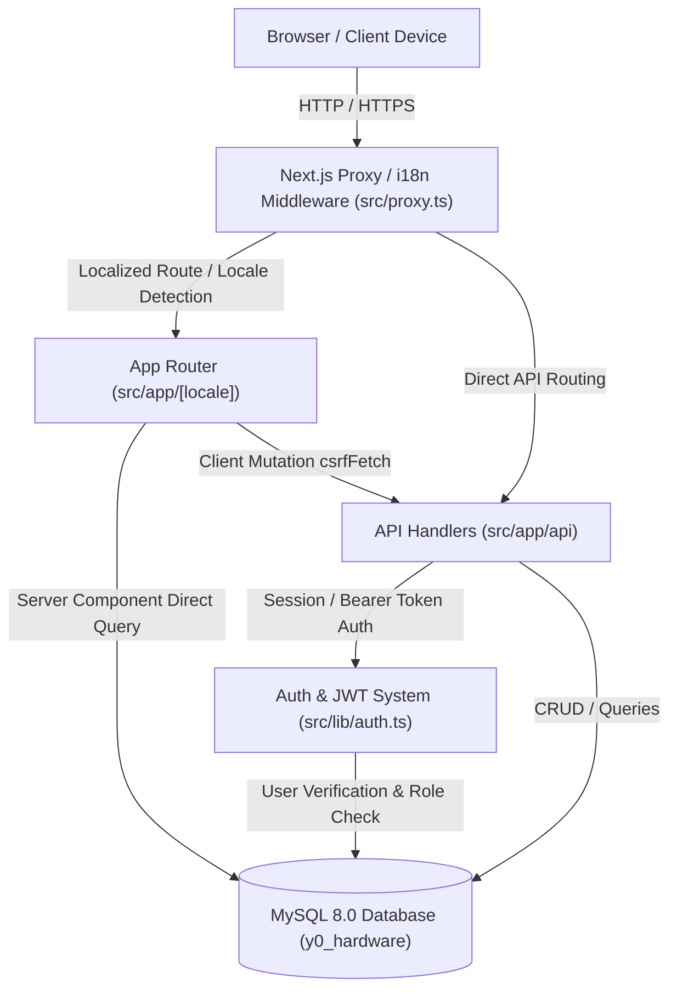
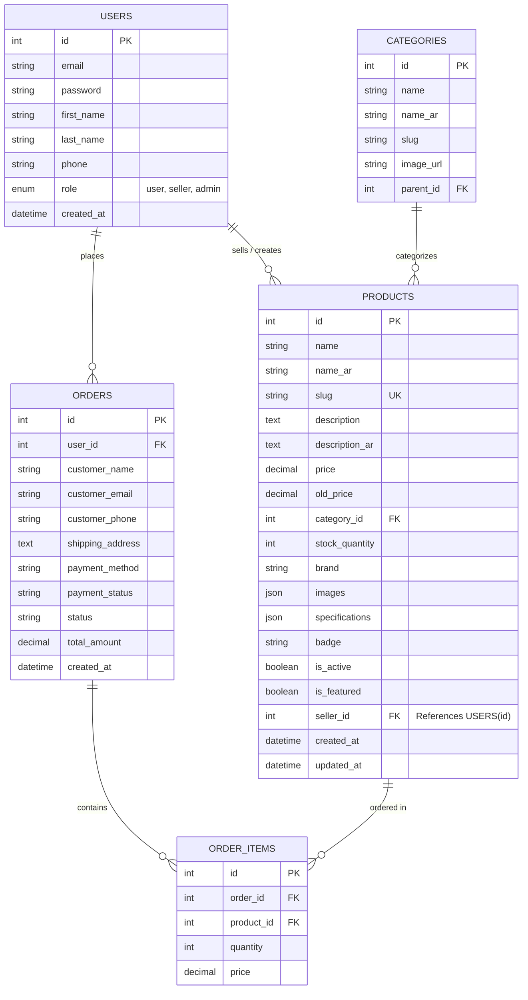

# 🏛️ Y0 Hardware Market - System Architecture & Route Blueprint (v1.3.12)

## 📌 Architectural Overview

The **Y0 Hardware Market** platform is built on Next.js 16 with the App Router architecture, paired with MySQL 8.0, Next-Intl (Arabic & English localization), and Tailwind CSS v4 featuring the cyber-industrial obsidian design system.

---

## 🗂️ Complete Directory & Route Map (40 Routes)

### 1. App Router Client / Page Routes (`src/app/[locale]`)
* `○ /_not-found`: Universal 404 page with cyber aesthetic.
* `ƒ /[locale]`: Storefront homepage featuring heroic deals, categories, and Silicon drops.
* `ƒ /[locale]/about`: Corporate and brand information ("About Us").
* `ƒ /[locale]/account`: Universal User Profile & Account hub with role indicators and direct dashboard launch.
* `ƒ /[locale]/admin`: High-density Cyber-Industrial Ops Command Center (Admin only).
* `ƒ /[locale]/auth/login`: Secure credential authentication with SameSite=Lax JWT sessions.
* `ƒ /[locale]/auth/register`: User onboarding with automatic persistence.
* `ƒ /[locale]/cart`: Cart review with persistent storage and item count HUD.
* `ƒ /[locale]/checkout`: Finalization of orders with Egyptian payment routing (InstaPay / Cash on Delivery).
* `ƒ /[locale]/contact`: Customer service portal and hotline dispatch (`+20 1129334173`).
* `ƒ /[locale]/drops`: Exclusive flash deals and limited-allocation silicon drops.
* `ƒ /[locale]/orders`: Personal order telemetry and history tracker.
* `ƒ /[locale]/product/[slug]`: High-performance hardware specification sheet and related hardware grid (direct DB query).
* `ƒ /[locale]/seller`: Dedicated Multi-Vendor Seller Portal for isolated inventory management.
* `ƒ /[locale]/shop`: Filterable hardware catalog with categories, price brackets, and real-time inventory counts (direct DB query).

### 2. Backend API Endpoints (`src/app/api`)

#### Admin Management Endpoints
* `ƒ /api/admin/orders`: List and update customer orders (GET, PUT).
* `ƒ /api/admin/products`: List and create catalog products (GET, POST with `seller_id` auto-binding).
* `ƒ /api/admin/products/[id]`: Update and delete individual products with ownership authorization checks (PUT, DELETE).
* `ƒ /api/admin/stats`: Telemetry metric aggregator (total revenue, active orders, hardware inventory).
* `ƒ /api/admin/users`: List users and modify permissions (`user` <-> `seller` <-> `admin`) (GET, PUT).

#### Authentication & Session Endpoints
* `ƒ /api/auth/login`: Issue secure JWT in `token` cookie with `SameSite=Lax`.
* `ƒ /api/auth/logout`: Invalidate session cookie.
* `ƒ /api/auth/me`: Validate active session token (returns `200 OK` with `user: null` for unauthenticated guests).
* `ƒ /api/auth/register`: Create user account with hashed password (`bcryptjs`).

#### Multi-Vendor Seller Endpoints
* `ƒ /api/seller/products`: Scoped endpoint for sellers returning only products matching their authenticated `seller_id`.

#### Public Catalog & Shop Endpoints
* `ƒ /api/cart`: Read active user cart items.
* `ƒ /api/cart/[productId]`: Add/remove items from user cart.
* `ƒ /api/orders`: Create new order and inspect user order records.
* `ƒ /api/products`: Filterable public products query with pagination and categorization.
* `ƒ /api/products/[id]`: Public single product lookup.
* `ƒ /api/products/[id]/related`: Fetch related products by category.
* `ƒ /api/products/categories`: Fetch hierarchy of product categories.
* `ƒ /api/products/featured`: Fetch featured hardware items.
* `ƒ /api/products/slug/[slug]`: Fetch product details by canonical slug.
* `ƒ /api/products/slugs`: List all active product slugs for static pre-rendering.
* `ƒ /api/revalidate`: On-demand ISR cache revalidator.
* `ƒ /api/upload`: Multipart image asset uploader for hardware images.

#### Static SEO Routes
* `○ /robots.txt`: Search engine crawling rules.
* `○ /sitemap.xml`: XML sitemap containing localized page links.

---

## 🔐 Multi-Tenant Role & Permissions Matrix

| Feature / Action | Guest | User | Seller | Admin |
| :--- | :---: | :---: | :---: | :---: |
| Browse Catalog & Silicon Drops | ✅ | ✅ | ✅ | ✅ |
| Rig Configurator & PC Builder | ✅ | ✅ | ✅ | ✅ |
| Account Registration & Login | ✅ | ✅ | ✅ | ✅ |
| Checkout & Place Orders | ❌ | ✅ | ✅ | ✅ |
| View Personal Order History | ❌ | ✅ | ✅ | ✅ |
| Access Profile Hub (`/[locale]/account`) | ❌ | ✅ | ✅ | ✅ |
| View Seller Dashboard (`/[locale]/seller`) | ❌ | ❌ | ✅ | ❌ |
| Create & List New Hardware Products | ❌ | ❌ | ✅ (Owned) | ✅ (Global) |
| Edit & Update Product Details | ❌ | ❌ | ✅ (Owned) | ✅ (Global) |
| Delete Hardware Products | ❌ | ❌ | ✅ (Owned) | ✅ (Global) |
| Access Admin Command Center (`/[locale]/admin`) | ❌ | ❌ | ❌ | ✅ |
| Review All Store Orders & Telemetry | ❌ | ❌ | ❌ | ✅ |
| Modify User Roles (`user` / `seller` / `admin`) | ❌ | ❌ | ❌ | ✅ |
| Edit Site Content & Hero Settings | ❌ | ❌ | ❌ | ✅ |

---

## 🗄️ Database Schema & Entity Relationships

The relational architecture is hosted on MySQL 8.0:

---

## 🛡️ Security & Performance Standard

1. **CSRF & Security Headers:** `rejectIfUnsafeMutation` guards state-mutating requests (`POST`, `PUT`, `DELETE`).
2. **Session Cookies:** Configured with `httpOnly: true`, `sameSite: 'lax'`, and standard expiration for seamless redirect recovery.
3. **Direct Database Calling in SSR:** Server Components (`/shop`, `/product/[slug]`) bypass network loopback self-fetches by querying the MySQL pool directly, ensuring zero downtime in standalone host environments.
4. **Webpack Production Flag:** Production build is strictly compiled with `next build --webpack` to avoid Turbopack CSS processing panics with Tailwind CSS v4.
5. **Persistent Asset Storage & Symlink Architecture (v1.3.8):** File uploads (`public/uploads`) are symbolically linked to `/home/u732920986/domains/hardwaremarket.y0ussef.com/public_html/uploads` on Hostinger VPS, decoupling persistent product media from versioned application builds (`hbuilds/versions/<version-id>/`). Handlers in `/api/upload` respect `process.env.UPLOAD_DIR` and authorize verified multi-vendor seller uploads.
6. **Automated Slugification & Featured Taxonomy (v1.3.9):** Product slugs are generated and sanitized with UTF-8 bilingual support (`src/lib/slug.ts`), eliminating dynamic route 404s. Showcase queries filter with index-accelerated `is_featured` boolean flags.
7. **Unified Image Asset Resolution (v1.3.10):** Universal image URL resolver (`src/lib/image.ts`) normalizes paths across local and production environments, standardizing relative `/uploads/...` paths and providing high-contrast dark placeholder assets.

---
*Designed & Powered by Y0ussef.com — Hotline: +20 1129334173*
