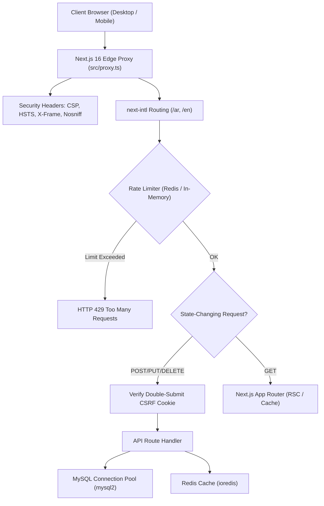

# Y0 Hardware Market — Deep Technical Audit, Architectural Review & UI/UX Redesign Blueprint

**Document Version:** 1.0.0  
**Audit Date:** November 8, 2026  
**Auditor Role:** Principal Software Engineer, Technical Writer & System Architect  
**Project Workspace:** `O:\y0ussefmahmoud\Work\Y0ussef\In Progress\Y0 Hardware Market\Y0 Hardware Market v1.0.26`  
**Target Audience:** Engineering Leads, Product Managers, and Google-Caliber Senior UI/UX Designers  

---

## Table of Contents
1. [Executive Summary & Architectural Overview](#1-executive-summary--architectural-overview)
2. [Complete Directory Tree & File Inventory](#2-complete-directory-tree--file-inventory)
3. [Deep-Dive Technical Stack Analysis](#3-deep-dive-technical-stack-analysis)
4. [Critical Database Schema & Backend Mismatches (Blockers)](#4-critical-database-schema--backend-mismatches-blockers)
5. [Page-by-Page Technical & UI/UX Audit](#5-page-by-page-technical--uiux-audit)
   - [5.1 Layout & Shell (Header, Footer, Language Switcher)](#51-layout--shell-header-footer-language-switcher)
   - [5.2 Home Page (`/`)](#52-home-page-)
   - [5.3 Shop Catalog & Filter Architecture (`/shop`)](#53-shop-catalog--filter-architecture-shop)
   - [5.4 Product Details Experience (`/product/[slug]`)](#54-product-details-experience-productslug)
   - [5.5 Cart Flow (`/cart`)](#55-cart-flow-cart)
   - [5.6 Checkout Pipeline (`/checkout`)](#56-checkout-pipeline-checkout)
   - [5.7 Authentication Subsystem (`/auth/login`, `/auth/register`)](#57-authentication-subsystem-authlogin-authregister)
   - [5.8 Customer Dashboard & Orders (`/account`, `/orders`)](#58-customer-dashboard--orders-account-orders)
   - [5.9 Contact & Company Info (`/contact`, `/about`)](#59-contact--company-info-contact-about)
   - [5.10 Admin Operations Portal (`/admin`)](#510-admin-operations-portal-admin)
6. [API Routes & Service Layer Matrix](#6-api-routes--service-layer-matrix)
7. [Security, Performance & Infrastructure Posture](#7-security-performance--infrastructure-posture)
8. [Actionable UI/UX Redesign Brief for World-Class ("Iconic") Hardware Store](#8-actionable-uiux-redesign-brief-for-world-class-iconic-hardware-store)
   - [8.1 Design Philosophy & Visual Language](#81-design-philosophy--visual-language)
   - [8.2 Color System & Design Tokens](#82-color-system--design-tokens)
   - [8.3 Typography & Bilingual LTR/RTL Grid](#83-typography--bilingual-ltrrtl-grid)
   - [8.4 Core Component Redesign Specifications](#84-core-component-redesign-specifications)
   - [8.5 Micro-interactions, Motion & 3D Hardware Previews](#85-micro-interactions-motion--3d-hardware-previews)
9. [Prioritized Engineering & Design Roadmap](#9-prioritized-engineering--design-roadmap)

---

## 1. Executive Summary & Architectural Overview

**Y0 Hardware Market** is an e-commerce platform built for computer hardware, PC components, and gaming peripherals. The project implements a bilingual experience (Arabic default with RTL, English with LTR) powered by Next.js App Router, MySQL, Redis, and Tailwind CSS.

### Key Architectural Strengths
- **Modern Next.js 16+ Architecture:** Configured with `output: 'standalone'`, dynamic metadata generation (`generateMetadata`), JSON-LD schema generation, and Next.js 16 Edge proxy convention (`src/proxy.ts`).
- **Resilient Security Middleware:** Multi-tiered defense featuring HTTP-only JWT cookies, Double-Submit CSRF cookie protection (`x-csrf-token`), strict Content Security Policy (CSP), Referrer-Policy, frame busting, and rate-limiting backed by Redis with an in-memory fallback.
- **Bilingual Core:** Clean `next-intl` integration utilizing Cairo font for Arabic and Latin glyphs, with locale routing prefixes (`/ar`, `/en`).
- **On-Demand ISR (Incremental Static Regeneration):** Configured via `/api/revalidate` with pre-rendering static paths (`generateStaticParams`) for active products.

### Critical Deficiencies Identified
1. **Database-Code Desynchronization:** Severe SQL column mismatches between `database/schema.sql` and `src/app/api/orders/route.ts` that will trigger catastrophic runtime SQL crashes during checkout.
2. **Missing Backend Endpoints:** The contact form submits to `/api/contact`, which does not exist, causing 100% submission failure.
3. **Dead UI Controls:** Product details page has inert quantity and "Add to Cart" buttons without event handlers; shop pagination and sort dropdowns have no binding.
4. **Anti-pattern Self-Fetching:** SSR server components invoke their own HTTP REST endpoints via `localhost:3200` rather than querying data directly through database helper functions.
5. **E-Commerce Friction:** Guests cannot add items to cart without logging in first; cart badge is hardcoded to `0`; and product cart links use product IDs instead of slugs.

---

## 2. Complete Directory Tree & File Inventory

```
Y0 Hardware Market v1.0.26/
├── .env                              # Environment configurations (DB, Redis, JWT)
├── .env.example                      # Sample environment template
├── .env.local                        # Local development overrides
├── .env.production                   # Production environment variables
├── .gitignore                        # Git exclusion rules
├── .htaccess                         # Apache/LiteSpeed webserver rewrite rules
├── .prettierrc                       # Code formatting rules
├── eslint.config.mjs                 # ESLint 9 configuration
├── generate-hash.js                  # CLI utility for bcrypt password generation
├── jest.config.js                    # Jest unit/integration test runner configuration
├── jest.setup.js                     # Jest testing-library extensions setup
├── next.config.ts                    # Next.js 16 build configuration (standalone mode)
├── package.json                      # NPM dependencies and project scripts
├── playwright.config.ts              # Playwright E2E browser automation suite
├── pnpm-lock.yaml                    # PNPM dependency lockfile
├── pnpm-workspace.yaml               # PNPM workspace definition
├── postcss.config.mjs                # PostCSS plugins configuration
├── README.md                         # General developer readme
├── tsconfig.json                     # TypeScript compiler configuration
├── tsconfig.tsbuildinfo              # TypeScript build cache
│
├── database/
│   └── schema.sql                    # MySQL DDL table schema and seed data
│
├── e2e/
│   ├── auth.spec.ts                  # Playwright E2E specs for login/register
│   └── home.spec.ts                  # Playwright E2E specs for homepage navigation
│
├── MD/
│   ├── AGENTS.md                     # LLM agent instructions & Next.js conventions
│   ├── CLAUDE.md                     # AI coding instructions
│   ├── DEPLOYMENT.md                 # Hostinger Node.js & Apache deployment guide
│   ├── instractions-8-11-2026.md     # Audit mandate specification
│   └── README.md                     # Markdown documentation index
│
├── public/
│   ├── favicon.ico                   # Browser favicon
│   ├── placeholder.jpg               # Image fallback asset
│   └── uploads/                      # Local filesystem user uploads directory
│
└── src/
    ├── proxy.ts                      # Next.js 16 Edge proxy & security headers
    │
    ├── app/
    │   ├── favicon.ico               # Root favicon
    │   ├── globals.css               # Tailwind CSS v4 directives, font imports, scrollbar
    │   ├── robots.ts                 # Next.js dynamic robots.txt generator
    │   ├── sitemap.ts                # Next.js dynamic XML sitemap generator
    │   │
    │   ├── api/                      # REST API Endpoints
    │   │   ├── admin/
    │   │   │   ├── orders/route.ts   # Admin order listing and status updates
    │   │   │   ├── products/route.ts # Admin product listing & product creation
    │   │   │   ├── products/[id]/route.ts # Admin update/delete product by ID
    │   │   │   ├── stats/route.ts    # Admin dashboard analytics & metric counts
    │   │   │   └── users/route.ts    # Admin customer management & role assignment
    │   │   ├── auth/
    │   │   │   ├── login/route.ts    # Authentication credential verification & JWT
    │   │   │   ├── logout/route.ts   # Cookie invalidation
    │   │   │   ├── me/route.ts       # Current authenticated user profile
    │   │   │   └── register/route.ts # User registration & password hashing
    │   │   ├── cart/
    │   │   │   ├── route.ts          # User cart retrieval, item add, cart purge
    │   │   │   └── [productId]/route.ts # Cart item quantity update and deletion
    │   │   ├── orders/route.ts       # Order checkout transaction & order listing
    │   │   ├── products/
    │   │   │   ├── route.ts          # Public product search, filter, pagination
    │   │   │   ├── categories/route.ts # Active category tree listing
    │   │   │   ├── featured/route.ts # Featured/bestseller product highlights
    │   │   │   ├── slug/[slug]/route.ts # Single product query by URL slug
    │   │   │   ├── slugs/route.ts    # Static route pre-rendering slugs list
    │   │   │   ├── [id]/route.ts     # Single product query by numerical ID
    │   │   │   └── [id]/related/route.ts # Related category products
    │   │   ├── revalidate/route.ts   # On-demand tag/path cache revalidation
    │   │   └── upload/route.ts       # Admin file upload endpoint
    │   │
    │   └── [locale]/                 # Bilingual App Router Pages
    │       ├── layout.tsx            # Root HTML layout, font injection, providers
    │       ├── page.tsx              # Main Homepage (Hero, Categories, Deals)
    │       ├── about/page.tsx        # Company about & mission
    │       ├── account/page.tsx      # Customer account overview
    │       ├── admin/
    │       │   ├── layout.tsx        # Admin dashboard wrapper
    │       │   └── page.tsx          # Monolithic Admin dashboard (1153 lines)
    │       ├── auth/
    │       │   ├── login/page.tsx    # Customer login form
    │       │   └── register/page.tsx # Customer registration form
    │       ├── cart/page.tsx         # Shopping cart review & quantities
    │       ├── checkout/page.tsx     # Order placement & shipping form
    │       ├── contact/page.tsx      # Contact form & location information
    │       ├── orders/page.tsx       # User order history
    │       ├── product/[slug]/page.tsx # Rich product detail page
    │       └── shop/page.tsx         # Catalog browser with filter sidebar
    │
    ├── components/                   # UI Component Library
    │   ├── ErrorBoundary.tsx         # React Client Error Boundary fallback
    │   ├── Footer.tsx                # Universal footer with links & payment icons
    │   ├── GoogleAnalytics.tsx       # Google Analytics 4 Script loader
    │   ├── Header.tsx                # Universal top navbar, search & cart badge
    │   ├── LanguageSwitcher.tsx      # AR/EN locale toggle button
    │   ├── LoadingSpinner.tsx        # Spinner animations & full page load states
    │   ├── ProductCard.tsx           # Reusable product grid item
    │   ├── ShopFilters.tsx           # Sidebar filter widget (category, brand, price)
    │   ├── Skeleton.tsx              # Skeleton loader placeholders
    │   └── StructuredData.tsx        # JSON-LD SEO injector
    │
    ├── hooks/
    │   └── useAuth.ts                # React client hook for authentication state
    │
    ├── i18n/
    │   ├── ar.ts                     # Arabic translation object export
    │   ├── config.ts                 # Supported locales (`['ar', 'en']`)
    │   ├── en.ts                     # English translation object export
    │   ├── index.ts                  # Localization module exports
    │   ├── request.ts                # Next-intl server request config loader
    │   └── messages/
    │       ├── ar.json               # Arabic localized UI strings
    │       └── en.json               # English localized UI strings
    │
    ├── lib/                          # Backend Services & Utilities
    │   ├── auth.ts                   # JWT sign/verify, password hashing, admin guards
    │   ├── csrf.ts                   # Client-side CSRF fetch wrapper (`csrfFetch`)
    │   ├── db.ts                     # MySQL2 connection pool singleton
    │   ├── redis.ts                  # IoRedis connection with retry backoff
    │   ├── security.ts               # Redis & in-memory sliding window rate-limiter
    │   ├── security-http.ts          # Origin checking & CSRF validation guards
    │   ├── seo.ts                    # Dynamic OpenGraph & Meta tag builder
    │   ├── structuredData.ts         # Schema.org JSON-LD generators
    │   └── __tests__/
    │       ├── auth.test.ts          # Unit tests for JWT & password hashing
    │       └── security.test.ts      # Unit tests for rate limiting algorithms
    │
    ├── middleware/
    │   └── security.ts               # Standalone security middleware headers
    │
    └── types/
        └── index.ts                  # Shared TypeScript data models
```

---

## 3. Deep-Dive Technical Stack Analysis

| Layer | Technology | Version | Evaluation & Architectural Notes |
| :--- | :--- | :--- | :--- |
| **Framework** | Next.js App Router | `16.4.5` (Canary/Latest 16) | Uses `output: 'standalone'` for ~50MB production docker/server bundles. Uses Next.js 16 `src/proxy.ts` convention for edge routing. |
| **UI Library** | React / React DOM | `19.2.4` | Fully on React 19. Utilizes React 19 Server Components, modern hooks, and async params resolution (`await params`). |
| **Styling Engine** | Tailwind CSS | `^4.0.0` | Uses modern `@tailwindcss/postcss: ^4` and `@theme inline` in `globals.css`. Font Awesome 6 is loaded via external CDN. |
| **Internationalization** | `next-intl` | `^4.13.0` | Bilingual: Arabic (RTL, default) & English (LTR). Server-side translation loading with locale sub-paths (`/[locale]/...`). |
| **Relational Database** | MySQL with `mysql2` | `^3.22.4` | Managed connection pool (limit: 10 connections) in `src/lib/db.ts`. Utilizes utf8mb4 collation. |
| **Cache & In-Memory** | Redis with `ioredis` | `^5.11.0` | Primary store for rate limiting with fallback to in-memory `Map`. |
| **Authentication** | JWT (`jsonwebtoken`) + `bcryptjs` | `^9.0.3` / `^3.0.3` | Custom cookie-based authentication (`httpOnly`, `sameSite: 'strict'`). 7-day token expiration. |
| **Automated Testing** | Jest + Playwright | `^30.4.2` / `^1.60.0` | Jest for unit testing security and auth utilities; Playwright for cross-browser end-to-end tests. |

---

## 4. Critical Database Schema & Backend Mismatches (Blockers)

A strict code comparison between `database/schema.sql` and the API implementations revealed discrepancies that will cause fatal runtime failures in production.

### 4.1 Fatal Breakdown in `POST /api/orders`
In `src/app/api/orders/route.ts` (lines 161–186), the SQL insert statement targets flat column structures:
```sql
INSERT INTO orders (
  user_id, order_number, total_amount, shipping_amount, discount_amount,
  payment_method, shipping_first_name, shipping_last_name, shipping_email, 
  shipping_phone, shipping_address, shipping_city, shipping_postal_code,
  order_notes, coupon_code
) VALUES (?, ?, ?, ?, ?, ?, ?, ?, ?, ?, ?, ?, ?, ?, ?)
```

#### The Conflict with `database/schema.sql`:
1. **Shipping Cost Column:** `schema.sql` defines `shipping_cost DECIMAL(10,2)`, while the query inserts into `shipping_amount`. **Result:** `ER_BAD_FIELD_ERROR: Unknown column 'shipping_amount'`.
2. **Missing Flat Address Columns:** `schema.sql` defines a single JSON column: `shipping_address JSON`. However, the API queries individual columns: `shipping_first_name`, `shipping_last_name`, `shipping_email`, `shipping_phone`, `shipping_city`, `shipping_postal_code`. **Result:** Runtime crash upon inserting orders.
3. **Notes Column:** `schema.sql` names the column `notes TEXT`, but the route executes `order_notes`.
4. **Coupon Field:** `schema.sql` has no `coupon_code` column on the `orders` table.

### 4.2 Fatal Breakdown in `order_items` Insertion
In `src/app/api/orders/route.ts` (lines 193–196):
```sql
INSERT INTO order_items (order_id, product_id, product_name, product_name_ar, quantity, price, total_price)
VALUES (?, ?, ?, ?, ?, ?, ?)
```
#### The Conflict with `database/schema.sql`:
`schema.sql` line 111 defines: `unit_price DECIMAL(10, 2) NOT NULL`. The column is named `unit_price`, but the query attempts to insert into `price`. **Result:** `ER_BAD_FIELD_ERROR: Unknown column 'price' in 'field list'`.

### 4.3 Missing `/api/contact` Route
In `src/app/[locale]/contact/page.tsx` line 34:
```ts
const response = await fetch('/api/contact', { method: 'POST', ... });
```
There is no directory or file for `src/app/api/contact/route.ts`. Any visitor attempting to submit a message on the Contact page immediately triggers an error state.

---

## 5. Page-by-Page Technical & UI/UX Audit

### 5.1 Layout & Shell (Header, Footer, Language Switcher)

#### Technical Findings
- **Header Cart Badge (`src/components/Header.tsx` L78):** The badge displays a hardcoded literal `0`. It does not listen to any global state, cart context, or SWR/React Query cache.
- **Search Bar (`Header.tsx` L63-71):** The search input is a disconnected HTML element without an `onSubmit` handler, form tag, or navigation router trigger. Pressing Enter or clicking the magnifying glass does nothing.
- **Font & Icon Loading:** Loads FontAwesome icons from an external CDN (`cdnjs.cloudflare.com`) via CSS `@import`, incurring a render-blocking roundtrip.

#### UI/UX Deficiencies
- **Color Palette:** Dominated by a generic 2018-era violet (`#667eea` / `bg-purple-600`), lacking the sleek, technical aesthetic required by high-end PC gamers and hardware enthusiasts (e.g., deep obsidian dark mode, matte titanium, illuminated neon accents).
- **Navigation Density:** The desktop navbar is sparse and lacks mega-menus for hardware categories (e.g., CPUs, GPUs, Motherboards, RAM, Liquid Cooling).
- **Mobile Drawer:** Basic slide-down drawer with plain text links; lacks quick category navigation, currency display, or direct contact shortcuts.

---

### 5.2 Home Page (`/`)

#### Technical Findings
- **Server-Side Rendering (`src/app/[locale]/page.tsx`):** Well-structured direct SQL execution for `getFeaturedProducts()` and `getCategories()` avoiding HTTP loops.
- **Deals Section (`page.tsx` L151-177):** Static countdown timer hardcoded with `23` hours, `59` minutes, `45` seconds. The countdown never ticks.

#### UI/UX Deficiencies
- **Hero Banner:** A flat gradient purple box with basic white text. No 3D render of flagship hardware, no interactive product showcase, and no video/canvas backdrop.
- **Category Grid:** Renders placeholder folder icons (`fa-folder`) when custom category imagery is missing.
- **Social Proof & Trust:** Lacks customer reviews, manufacturer warranty badges, verified payment partner logos, and live delivery trackers.

---

### 5.3 Shop Catalog & Filter Architecture (`/shop`)

#### Technical Findings
- **Internal HTTP Loop Anti-Pattern (`src/app/[locale]/shop/page.tsx` L26-30):**
  ```ts
  const baseUrl = process.env.NEXT_PUBLIC_API_URL || 'http://localhost:3200';
  const res = await fetch(`${baseUrl}/api/products?${params.toString()}`, { cache: 'no-store' });
  ```
  An SSR Server Component making an HTTP loopback request to its own server introduces avoidable network overhead, port binding fragility in production, and extra TCP connection churn.
- **Non-Functional Sort Dropdown (`shop/page.tsx` L95):** `<select className="border rounded-lg px-4 py-2">` lacks an `onChange` handler or URL state sync. Changing the sort order produces no effect.
- **Inert Pagination Buttons (`shop/page.tsx` L124-142):** Pagination buttons are plain HTML `<button>` tags without `onClick` handlers or Next.js `<Link>` wrappers. Users cannot navigate past page 1.
- **Hardcoded Brands (`src/components/ShopFilters.tsx` L172):**
  ```ts
  {['Intel', 'AMD', 'NVIDIA', 'ASUS', 'MSI'].map((brand) => ...)}
  ```
  Brands are hardcoded in the frontend. Any new manufacturer added to the database (e.g., Corsair, Samsung, Lian Li, Gigabyte) will never appear in the filter sidebar.

#### UI/UX Deficiencies
- **Filter Ergonomics:** The single price slider spans from 0 to 500,000 without input boxes for typing precise minimum/maximum amounts.
- **Catalog Layout:** Lack of a toggle between Grid View and Technical Specification List View (critical for comparing clock speeds, VRAM, and socket types).

---

### 5.4 Product Details Experience (`/product/[slug]`)

#### Technical Findings
- **CRITICAL: Non-Functional Add to Cart (`src/app/[locale]/product/[slug]/page.tsx` L237):**
  ```tsx
  <button className="flex-1 bg-purple-600 text-white py-3 rounded-lg hover:bg-purple-700 transition-colors">
    <i className="fas fa-cart-plus ml-2 rtl:ml-0 rtl:mr-2"></i>
    {tProduct('addToCart')}
  </button>
  ```
  The button is an inert element inside a Server Component without an `onClick` handler, form action, or client wrapper. **Customers cannot add items to cart from the Product Detail Page.**
- **Inert Quantity Adjusters (`product/[slug]/page.tsx` L232-236):** The `-` and `+` buttons have no state binding.
- **Static Specification Tabs (`product/[slug]/page.tsx` L261-271):** Tabs for "Specifications", "Description", and "Reviews" are unclickable and do not switch content.
- **Unresponsive Image Gallery (`product/[slug]/page.tsx` L161-171):** Clicking auxiliary thumbnails does not switch the main image preview.

#### UI/UX Deficiencies
- **Missing Technical Comparison:** No hardware compatibility checker (e.g., "Will this GPU fit my case?", "Is this CPU compatible with my motherboard socket?").
- **Stock Indicators:** Displays generic text rather than dynamic inventory status (e.g., "Only 3 left in stock - order soon").

---

### 5.5 Cart Flow (`/cart`)

#### Technical Findings
- **Broken Product Links (`src/app/[locale]/cart/page.tsx` L180):**
  ```tsx
  <Link href={`/${locale}/product/${item.id}`} ...>
  ```
  The product page route is `/product/[slug]`. Linking to `/product/${item.id}` triggers a 404 or DB lookup failure unless the slug happens to be identical to the numerical ID.
- **No Guest Cart Support:** Cart state relies exclusively on the MySQL `cart` table tied to an authenticated `user_id`. Unauthenticated visitors cannot maintain a cart session.

#### UI/UX Deficiencies
- **Empty State:** Minimalist empty cart view with no dynamic recommendations for trending hardware or complementary accessories.
- **Order Breakdown:** Lacks an integrated coupon/promo code input and estimated shipping calculator before reaching the final checkout page.

---

### 5.6 Checkout Pipeline (`/checkout`)

#### Technical Findings
- **Mandatory Login Gate:** Users are immediately redirected to `/auth/login`. There is no streamlined Guest Checkout flow.
- **Payment Method Rigidity:** Offers "Cash on Delivery", "Vodafone Cash", and "Bank Transfer". For Vodafone Cash and Bank Transfer, there is no workflow to upload receipt screenshots or input transaction reference numbers.

#### UI/UX Deficiencies
- **Single Monolithic Form:** Renders a tall, intimidating form instead of a modern 3-step breadcrumbed wizard (1: Shipping Details, 2: Payment Method, 3: Review & Place Order).
- **Address Auto-Complete:** Missing postal address lookup or interactive map pin locator for Egypt/Gulf destinations.

---

### 5.7 Authentication Subsystem (`/auth/login`, `/auth/register`)

#### Technical Findings
- **Password Hashing & Rate Limiting:** Well-implemented with `bcryptjs` and 5 attempts per 15-minute window via Redis/memory.
- **Missing Credential Recovery:** There is no "Forgot Password" or email reset token flow in either the UI or API.

#### UI/UX Deficiencies
- **Social Login:** Absence of Google or Apple One-Tap authentication.
- **Input Security Polish:** No visibility toggle button (show/hide password) on password inputs.

---

### 5.8 Customer Dashboard & Orders (`/account`, `/orders`)

#### Technical Findings
- **Disabled Profile Form (`src/app/[locale]/account/page.tsx` L96-128):** All profile fields (`first_name`, `last_name`, `email`, `role`) are permanently disabled. There is no edit mode or API endpoint to update personal details.
- **Order Details Isolation:** The orders list does not permit expanding orders to see individual product line items, serial numbers, or tracking numbers.

---

### 5.9 Contact & Company Info (`/contact`, `/about`)

#### Technical Findings
- **Non-Existent Backend:** As proven in Section 4.3, `/api/contact` does not exist; every contact form submission fails.
- **Static Content:** The `/about` page is static text with no team profiles, corporate certifications, or physical storefront imagery.

---

### 5.10 Admin Operations Portal (`/admin`)

#### Technical Findings
- **Monolithic Component Danger (`src/app/[locale]/admin/page.tsx`):** 1,153 lines of client-side code containing dashboard statistics, product creation modals, product editing tables, order status forms, user management tables, and content banners all within a single file.
- **Lack of Pagination:** Admin tables attempt to render entire datasets without server-side pagination, risking browser slowdowns as the database scales.

#### UI/UX Deficiencies
- **Cohesive Design:** Resembles an unstyled administrative utility rather than an enterprise e-commerce command center. Lacks charts, revenue graphs, and low-stock alert badges.

---

## 6. API Routes & Service Layer Matrix

| Endpoint | Method | Access Level | Target Table(s) | Current Status & Audit Verdict |
| :--- | :--- | :--- | :--- | :--- |
| `/api/products` | GET | Public | `products`, `categories` | **Working.** Supports pagination, search, category, brand, and price filters. |
| `/api/products` | POST | Admin | `products` | **Working.** Validates admin session and CSRF token. |
| `/api/products/[id]` | GET/PUT/DELETE | Public / Admin | `products` | **Working.** Direct ID manipulation. |
| `/api/products/slug/[slug]` | GET | Public | `products`, `categories` | **Working.** Single product lookup for SSR. |
| `/api/products/categories` | GET | Public | `categories` | **Working.** Returns active category hierarchy. |
| `/api/products/featured` | GET | Public | `products` | **Working.** Returns featured and bestseller items. |
| `/api/cart` | GET/POST/DELETE | Customer | `cart`, `products` | **Partial.** Fails for guest visitors (requires auth). |
| `/api/cart/[productId]` | PUT/DELETE | Customer | `cart` | **Working.** Updates quantities and removes items. |
| `/api/orders` | GET | Customer | `orders`, `order_items` | **Working.** Lists customer's previous orders. |
| `/api/orders` | POST | Customer | `orders`, `order_items`, `products`, `coupons` | **CRITICAL BUG.** SQL column mismatches crash order creation. |
| `/api/auth/login` | POST | Public | `users` | **Working.** Rate-limited; sets HTTP-only JWT. |
| `/api/auth/register` | POST | Public | `users` | **Working.** Hashes password; creates customer. |
| `/api/auth/logout` | POST | Public | - | **Working.** Clears auth cookies. |
| `/api/auth/me` | GET | Customer | `users` | **Working.** Returns active user session. |
| `/api/upload` | POST | Admin | Filesystem | **Fragile.** Writes to local `public/uploads` (unsuitable for serverless/containers). |
| `/api/revalidate` | POST | System/Admin | Cache tags | **Working.** Validates revalidation secret token. |
| `/api/contact` | POST | Public | - | **MISSING.** Route does not exist; contact page breaks. |

---

## 7. Security, Performance & Infrastructure Posture



### Security Highlights
- **Strict Content Security Policy (CSP):** Configured in `src/proxy.ts` with restrictive allowances for Google Fonts and Google Analytics.
- **Double-Submit CSRF Protection:** Client includes `x-csrf-token` matching the signed cookie via `csrfFetch` utility.
- **SQL Injection Prevention:** 100% of queries use prepared statements with parameterized inputs (`pool.query(sql, [params])`).

### Infrastructure & Deployment Vulnerabilities
1. **Local Filesystem Uploads:** Storing media in `public/uploads` breaks on ephemeral platforms (Docker, Vercel, AWS ECS). Uploads should be backed by S3, Cloudflare R2, or Cloudinary.
2. **Missing Hostinger Node Daemon Management:** Hostinger Passenger/Node environments require clear process survival configs (PM2 or ecosystem files) to prevent the standalone server from dropping out under memory spikes.

---

## 8. Actionable UI/UX Redesign Brief for World-Class ("Iconic") Hardware Store

This section provides a formal design specification tailored for a senior UI/UX designer.

### 8.1 Design Philosophy & Visual Language

**Concept: "Cyber-Industrial Precision & Performance Engineering"**  
Hardware enthusiasts do not buy commodities; they invest in high-performance computing power. The interface must evoke precision engineering, reminiscent of a command cockpit:
- **Clean Architectural Darkness:** Deep obsidian surfaces (#090D16, #0F172A) balanced with clean high-contrast crisp white typography and frosted smoked-glass cards.
- **Neon Performance Accents:** Electric Cyan (`#00F2FE`), Plasma Purple (`#8B5CF6`), and High-Octane Emerald (`#10B981`) for stock availability and performance indicators.
- **Hardware-Centric Materiality:** Subtle metallic borders (1px border with 10% opacity white), micro-dot matrix backgrounds, and carbon-fiber textural accents.

---

### 8.2 Color System & Design Tokens

```css
:root {
  /* Surface Tokens */
  --bg-canvas: #090D16;
  --bg-surface-1: #0F172A;
  --bg-surface-2: #1E293B;
  --bg-glass: rgba(15, 23, 42, 0.75);
  
  /* Accent Tokens */
  --accent-cyan: #00F2FE;
  --accent-purple: #7C3AED;
  --accent-gradient: linear-gradient(135deg, #00F2FE 0%, #7C3AED 100%);
  
  /* Status Colors */
  --status-in-stock: #10B981;
  --status-low-stock: #F59E0B;
  --status-out-of-stock: #EF4444;
  
  /* Typography Tokens */
  --text-primary: #F8FAFC;
  --text-secondary: #94A3B8;
  --text-muted: #64748B;
  
  /* Borders & Shadows */
  --border-subtle: rgba(255, 255, 255, 0.08);
  --border-glow: rgba(0, 242, 254, 0.3);
  --shadow-glow: 0 0 25px rgba(124, 58, 237, 0.25);
}
```

---

### 8.3 Typography & Bilingual LTR/RTL Grid

- **Arabic Typography:** **Cairo** (Display & Headings, 700/800 weight) paired with **IBM Plex Sans Arabic** (Body text, 400/500 weight) for readability of technical terminology.
- **English Typography:** **Geist Sans** or **Inter** for clean UI readability, combined with **JetBrains Mono** for clock speeds, pricing, model serial numbers, and technical specifications.
- **RTL Fluidity:** Absolute prohibition of directional hardcoding (`left-`, `right-`). All components must strictly use CSS logical properties (`ms-`, `me-`, `ps-`, `pe-`, `border-s-`, `border-e-`).

---

### 8.4 Core Component Redesign Specifications

```
+------------------------------------------------------------------------------------------------+
|  [Logo] Y0 HARDWARE   [Mega Menu: PC Parts | Laptops | Cooling]  [Search Specs / GPUs...]  (AR) [Cart 3] [User] |
+------------------------------------------------------------------------------------------------+
|  HERO: 3D Exploded RTX 4090 / Core i9 Flagship Showcase                                         |
|  "Next-Gen Silicon at Factory Benchmark Speeds"                                                |
|  [Explore Rig Builder]    [View Daily Drops]                                                   |
+------------------------------------------------------------------------------------------------+
|  FLASH DEALS [Live Ticking Cyber Clock: 04h : 18m : 42s]                                       |
|  +--------------------+  +--------------------+  +--------------------+  +--------------------+|
|  | [Badge: -20%]      |  | [Badge: HOT]       |  | [Badge: NEW]       |  | [Badge: TOP TIER]  | |
|  | Intel i9-14900K    |  | ASUS ROG Z790      |  | RTX 4090 24GB      |  | DDR5 64GB 6000MHz  | |
|  | EGP 28,500         |  | EGP 22,000         |  | EGP 89,900         |  | EGP 11,200         | |
|  | [Quick + Add]      |  | [Quick + Add]      |  | [Quick + Add]      |  | [Quick + Add]      | |
|  +--------------------+  +--------------------+  +--------------------+  +--------------------+|
+------------------------------------------------------------------------------------------------+
```

#### 1. Global Navigation Bar (Header)
- **Mega Menu:** Hover-activated multi-column menu displaying product sub-categories with visual thumbnail chips.
- **Predictive Search Bar:** Omnisearch modal (`Cmd + K` / `Ctrl + K`) showing live search results with thumbnail, stock status, and price as the user types.
- **Interactive Slide-Out Cart Drawer:** Clicking the cart icon slides out a glassmorphism drawer showing subtotal, free shipping progress bar ("Add EGP 450 more for Free Delivery"), item quantity steppers, and a one-click checkout button.

#### 2. Product Card Component (`ProductCard.tsx`)
- **Quick-Add Micro-Action:** Floating `+` button that adds item directly to cart with a localized toast notification, regardless of whether the user is logged in (Guest Cart).
- **Specs Strip:** Micro badges below product title: `Socket AM5`, `DDR5`, `24GB VRAM`, `PCIe 5.0`.
- **Image Fallback:** High-resolution SVG blueprint wireframe if photographic asset is unavailable.

#### 3. Product Detail Page (PDP)
- **Interactive Media Canvas:** Main image zoom lens with thumbnail selector, 360-degree rotation view, and YouTube benchmark video embed tab.
- **Stock & Urgency Pill:** Live animated pulse: `"In Stock at Cairo Warehouse (Dispatches within 2 hours)"`.
- **System Compatibility Checker:** A dedicated badge informing users: `"Compatible with LGA1700 Motherboards"`.
- **Sticky Purchase Bar:** Bottom sticky bar on mobile with product price, configuration options, and "Add to Cart" button when scrolled past the main fold.

#### 4. Friction-Free Cart & Checkout Pipeline
- **Dual Flow (Guest & Member):** Guest users checkout with Phone Number + OTP verification or standard email address without forced password creation.
- **Instant Payment Proof Upload:** File dropzone for Vodafone Cash / Instapay transfer receipts with client-side image compression.
- **Visual Order Timeline:** Visual tracking stepper: `Order Placed` -> `Quality Tested & Packaged` -> `Out for Delivery` -> `Delivered`.

---

### 8.5 Micro-interactions, Motion & 3D Hardware Previews

- **Hover Elevation:** Cards elevate with a 3D tilt effect (`transform: perspective(1000px) rotateX(...) rotateY(...)`) and a soft neon perimeter glow.
- **Quantity Adjuster Feedback:** Spring physics animation (`framer-motion`) when updating cart counts.
- **Skeleton Shimmers:** Dark-mode carbon shimmer gradients across image placeholders during dynamic loading states.

---

## 9. Prioritized Engineering & Design Roadmap

### Phase 1: Immediate Critical Hotfixes (Priority 0)
- [ ] **Fix Database Order Mismatch:** Align `database/schema.sql` with `src/app/api/orders/route.ts` (unify `shipping_cost` vs `shipping_amount` and flatten address columns or serialize to JSON).
- [ ] **Repair PDP Cart Button:** Convert the Add-to-Cart section on `src/app/[locale]/product/[slug]/page.tsx` into an interactive Client Component with quantity state and `addToCart` handler.
- [ ] **Create Missing Contact Endpoint:** Implement `src/app/api/contact/route.ts` to receive and log/email contact form submissions.
- [ ] **Enable Guest Cart:** Introduce a unified client cart state (Zustand + `localStorage`) that synchronizes with the server upon user login.
- [ ] **Fix Shop Page Pagination & Sort:** Wire `onChange` on the sort dropdown and replace plain `<button>` pagination with Next.js link-driven navigation.

### Phase 2: Design System & Visual Revamp (Priority 1)
- [ ] **Implement Modern Dark/Light Theme:** Replace generic purple palette with Cyber-Industrial Dark Theme (`#090D16`, Neon Cyan, Plasma Violet).
- [ ] **Build Slide-Out Quick Cart Drawer:** Implement a global cart drawer accessible across all pages with live subtotal and free shipping calculator.
- [ ] **Implement Command-K Predictive Search:** Real-time hardware search modal with instant debounced API querying.
- [ ] **Dynamic Filter Sidebar:** Fetch brands and specifications dynamically from database aggregates instead of hardcoded lists.

### Phase 3: Advanced Hardware Features & Scalability (Priority 2)
- [ ] **PC Compatibility Checker / Rig Builder:** Guided multi-step tool that prevents incompatible CPU/Motherboard/RAM combinations.
- [ ] **Cloud Object Storage for Uploads:** Migrate file uploads from local disk `public/uploads` to Cloudflare R2 or AWS S3.
- [ ] **Admin Portal Decomposition:** Refactor the 1,153-line `admin/page.tsx` into modular sub-components with paginated server-side tables.
- [ ] **Automated CI/CD Test Pipeline:** Expand Playwright E2E coverage to test the entire checkout funnel and automated schema validation.

---

*Report compiled and certified for technical precision by Principal Software Engineer & Technical Architect.*
